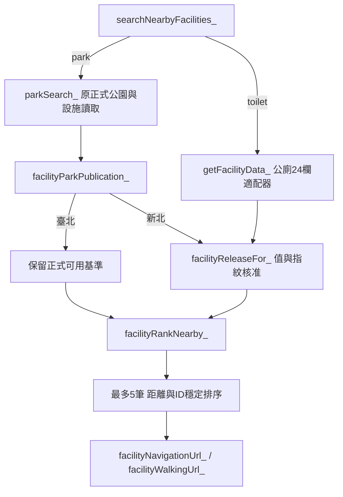

# MVP 1.0 P0-1：共用設施搜尋與公廁適配器

日期：2026-10-21。分支`feature/flex-message-v2`；應用程式基準`26b7842`，先保存盤點文件至`90ceaac`，測試先行Commit `dff6034`。本階段只實作離線可驗收的搜尋核心，沒有部署或資料同步。

## 已完成與未啟用範圍

新增唯讀公廁適配器，公園與公廁共用原`parkDistanceKm_`、3km含邊界／誤差容許、距離升冪／同距離ID排序、最多5筆及walking導航URL組裝。原始距離函式不搬移，保留附件B3對公園helper的相依；沒有修改park_geocoding或停車函式。

`gas/line_webhook_gas.js`完全不變，尚未提供公廁指令、三分類選單、公廁Flex或使用者錯誤提示。新增的是後續router可呼叫的server-side API，不宣稱LINE公廁功能已上線。

**沒有核准清單時，新北公園及公廁結果為0；不是重新核准既有9筆。** 臺北公園保留原「可用＋有效座標＋唯一ID」正式基準。原始9筆新北座標／來源資料未改動。缺清單只會排除新北；若清單存在但表頭錯誤，會明確拋錯，不能把格式錯誤當成成功或默認核准。

## 程式與檔案差異

| 檔案 | 改動 |
|---|---|
| `gas/facility_search_gas.js`（新增） | 公廁24欄adapter、核准清單／指紋、共用距離排序、walking導航與結果一致性檢查；無寫入、geocoding或LINE呼叫 |
| `gas/park_search_gas.js` | 新北發布gate、結果補共用欄位，排序與URI委派共用核心；保留原臺北遊具／文字／Flex與意圖行為 |
| `test/facilities/fixtures/toilets.json`（新增） | 合成資料，依真實24欄schema；沒有真實公廁發布清單 |
| `test/facilities/helpers.mjs`（新增） | 使用既有GAS VM harness；獨立Node SHA-256參考序列化，建立顯式合成核准 |
| `test/facilities/search.test.mjs`（新增） | 77項功能、邊界、品質及核准失效案例 |
| `test/parks/helpers.mjs` | 載入公園時同步載入新增共用模組，反映新的程式相依；不隱藏或自動建立核准 |
| `test/parks/mvp.test.mjs`、`search.test.mjs` | 為原新北／邊界fixtures明確提供合成核准，不減少或改弱原斷言 |
| `.github/workflows/offline-tests.yml` | 加77項設施測試與`facilities.tap`保存，不增加部署或秘密相依 |
| `gas/README.md`、本文件 | 相依、唯讀核准表契約、限制與操作／回復說明 |

盤點報告四份另於`90ceaac`保存，內容是前一階段分析快照；本文件是P0-1狀態更新。完整diff與Commit回執位於本輪`.local/mvp1-p01-20261021/`交付包。

## 共用架構及API



- `searchNearbyFacilities_(kind, lat, lon)`：kind僅`park`／`toilet`；停車或未知類別明確拋錯，不轉查停車。park委派原一般公園模式，toilet經adapter後進共用排序。
- `toiletSearch_(lat, lon)`：公廁入口，僅讀新北主表；不依使用者所在城市排除另一側的新北結果。
- `getFacilityData_('toilet')`：只回傳已通過發布條件的資料，不讀公廁明細、不讀公園候選、不呼叫Maps。臺北公廁不在本階段範圍。
- `facilityRankNearby_`：共用內部kernel，以原公園距離函式及常數3km／5筆排序；不修改來源物件。只供已經adapter／發布gate篩選的資料使用，不能當成原始未核准資料發布器。
- 公園及公廁結果共用`kind,id,name,city,district,address,lat,lon,km,sourceStatus,sourceFingerprint,positionType,publication`。公園仍有原tags；公廁另有`openingHours,accessRestrictions,accessibility,changingTable`。
- `facilityNavigationUrl_(result)`：從搜尋結果產生編碼的Google Maps walking URI；檢查類別／ID、座標與publication快照一致及指紋格式，拒絕原始列／無效座標／目的地改值。publication是可信server-side流程的資料一致性資訊，**不是簽章或對不可信呼叫者的授權Token**，不能讓LINE用戶傳入自行建構的publication。
- 舊`parkNavigationUrl_`保留介面，委派共用`facilityWalkingUrl_`；這個內部URI組裝器本身不讀核准表，正式公園呼叫鏈的發布gate在`parkSearch_`。停車`navUrl`的driving完全未改。

新模組與公園檔必須一起載入；本輪只修改Git原始碼，未將新模組複製到正式GAS。GAS的全域函式載入後可互相呼叫，沒有top-level Sheets或API作業。

## 公廁適配與資料品質

表名固定`公廁資料`，重用`PARK_SHEET_ID`開啟同一工作簿。依欄名讀取，支援欄序調整；需具備ODS的24個canonical欄位，缺欄／空白或重複表頭拋錯，不猜測欄位別名。

必要條件：ID非空文字且唯一、新北市、名稱／行政區／地址／資料來源ID為非空文字、經緯度嚴格數值格式並在粗範圍24.7–25.4／121.2–122.1內；此矩形不代替行政區或入口驗證。布林、空值、NaN、Infinity、非數字／十六進位字串及疑似TWD97 XY均不作導航座標。

- `資料狀態`只接受`可用`或`待驗收`，兩者都**另外需要完整人工發布核准**。`待確認`、停用、未知及缺值均排除。
- `整併狀態`只接受`保留獨立`或`自動整併`，且仍需核准記錄的`資料驗收=已確認`；待人工確認／未知不得放行。這不表示自動整併本身就是核准。
- 原始待驗收狀態保留為`sourceStatus`，不修改來源、也不自動改成可用；發布決定獨立存於唯讀核准清單。
- 空的開放時間／無障礙／尿布臺／進入限制投影為`UNKNOWN`；既有文字原樣保留，不解讀為無設施、24小時或可無障礙到達。
- 不以相同座標合併不同ID；不join明細造成主表倍增。來源重複ID或重複核准（即使第二列是撤銷）都排除該ID。

## 發布核准清單規格：僅提出，不建立正式表

不新增Script Properties、不寫入正式設定。未來若核准使用此方案，需在同一本工作簿由受控人工流程維護`設施發布核准`；目前程式只讀，沒有建表／匯入／核准函式。資料表可調整欄序，但必須具有以下11欄：

| 欄位 | 契約 |
|---|---|
| 設施類別 | `公園`或`公廁`；不同類別不能借用同ID核准 |
| 設施ID | 與來源ID相符；同類別只能一列 |
| 來源資料指紋 | SHA-256小寫hex，依下述固定v1規則；計算指紋不是核准動作 |
| 緯度／經度 | 均須為有效座標，轉成數字後與來源完全相等 |
| 資料驗收 | 必須`已確認` |
| 發布決定 | 必須`核准發布`，待審／撤銷都不通過 |
| 核准人 | 非空文字，不能布林或數字 |
| 核准日期 | 文字`YYYY-MM-DD`，真實日期、不可未來；在試算表請明確用純文字儲存，本版不猜測Date物件或本地日期格式 |
| 證據URL | HTTPS網址，不允許憑證、空白、javascript等scheme；語法通過不證明來源官方或證據足夠 |
| 座標代表類型 | 公園：園區代表點／入口／未知；公廁：設施代表點／入口／未知。未知不得推定入口 |

指紋v1：`JSON.stringify([kind, fixedHeaders.map(key => [key, normalizedValue])])`，UTF-8 SHA-256。kind為park／toilet；fixedHeaders分別是程式中的15欄／24欄固定順序。緯經度轉Number；Date轉UTC ISO字串；其他值null／undefined視空字串再轉文字trim。公園舊schema未提供的非必要欄位視空字串。這是欄位值指紋，不是整個ODS檔案雜湊；原始檔SHA仍需在人工審核流程另存。

所有canonical欄位都納入，包含名稱、行政區、地址、狀態、同步時間等。來源值或座標改變使核准失效，不能僅依名稱或ID沿用。數字與同值十進位字串規範化相同；空白trim等規範化不是原檔位元相等。本版沒有核准有效期設定，核准日期僅驗格式與非未來；如需到期政策須另行定義。

核准清單是受信任的管理資料；程式不會驗證核准人真實身分、證據內容、原始資料完整來源或Sheet編輯權限。後續開放給不可信外部資料匯入前，必須另做人工回收／審核權限驗證。合成fixtures的核准不可匯入正式表，既有9筆不自動產生核准。

## 測試先行與實際結果

| 階段 | 實際結果 |
|---|---|
| 初始62項設施案例，程式尚未實作 | 0 pass／62 fail；缺少adapter／core／發布gate，已提交`dff6034` |
| 補共用park結果／導航一致性案例 | 71 pass／1 fail，修正park結果shape與共用導航檢查後全過 |
| 補文字型別品質案例 | 72 pass／5 fail，修正非文字ID／名稱／區／來源及核准人後全過 |
| 最終新設施套件 | **77／77 pass** |
| 既有公園／Webhook／mock同步回復 | **170／170 pass**；原斷言保留，新北fixtures增加顯式合成發布證據 |
| 既有停車 | **72／72 pass**；測試與產品停車程式皆未修改 |
| 官方來源工具 | **33／33 pass** |
| 審核表工具 | **22／22 pass** |
| 合計 | **374項全過**；沒有skip／cancel |
| GAS語法、actionlint、git diff --check | 通過 |

重跑命令（repo根目錄）：

```bash
node --test --test-reporter=tap test/facilities/*.test.mjs
node --test --test-reporter=tap test/parks/*.test.mjs
node --test --test-reporter=tap test/parking/*.test.mjs
python -m unittest discover -s test/park_sources -v
python -m unittest discover -s test/park_review -v
for file in gas/*.js; do node --check "$file" || exit 1; done
```

原始stdout、紅燈紀錄與完整diff另存`.local/mvp1-p01-20261021/`。CI新增設施步驟，但遠端Actions結果未讀回。沒有重跑sponsor-worker測試，不把舊25項視為本輪通過。

## 尚未解決與下一階段

- 公廁搜尋未接LINE，GAP-01／02的三分類及切換清除仍待下一階段。建議先寫park→parking、toilet→park、回選單、TTL／群組隔離失敗測試，再改Webhook。
- GAP-03已在新北正式搜尋加發布gate，但真實核准子集仍為尚未提供。沒有新核准，不宣稱新北公廁或9筆公園已可發布。
- GAP-04：原公園仍要求設施表；為保持原170項行為，本階段不解除舊schema契約。後續移除遊具入口時，可獨立拆分一般附近搜尋並新增缺設施表案例。
- GAP-05：缺表／欄位／讀取錯誤會明確拋錯，但原Webhook只log的使用者提示仍未改。下一階段需分類文字，不可掉回停車。
- GAP-06：本階段公廁與共用導航有嚴格座標與publication檢查；既有`flexBubble`的有限數檢查未改，不能直接把原始公廁列交給它。
- 暫不新增遊具篩選；既有臺北篩選及選單保留至三分類改版，不新增或推造公廁設施。
- 公廁真實缺區、共點、整併與明細ID問題、實際入口／樓層、來源時效、負載仍待人工與隔離驗收；本輪沒有讀寫正式Sheets或重做真實資料審核。
- 沒有官方LINE schema、正式GAS／LINE／手機導航或真實Sheet核准表讀回驗證。離線通過不代表正式驗收。

## Git及回復方式

實際SHA與diff見交付`FINAL_RECEIPT.json`及`P0-1.diff`；不合併main，不部署、不推送正式服務。規劃文件Commit `90ceaac`、紅燈測試Commit `dff6034`與實作Commit分開保存。

若只回復本輪功能，在工作分支先確認無未提交修改，建立**新revert commit**（本輪不執行）：

```bash
git revert --no-commit <P0-1實作Commit> dff6034
git diff --cached
# 核對後執行原公園／停車回歸，再commit回復
```

兩個commit要一起回復，避免只回復程式後留下必然失敗的新測試；`90ceaac`的盤點文件可保留。無正式資源寫入，因此本輪不需要Sheets／GAS／Webhook資料回復。未來正式操作仍需另提備份／回復與風險計畫，並取得明確核准。
