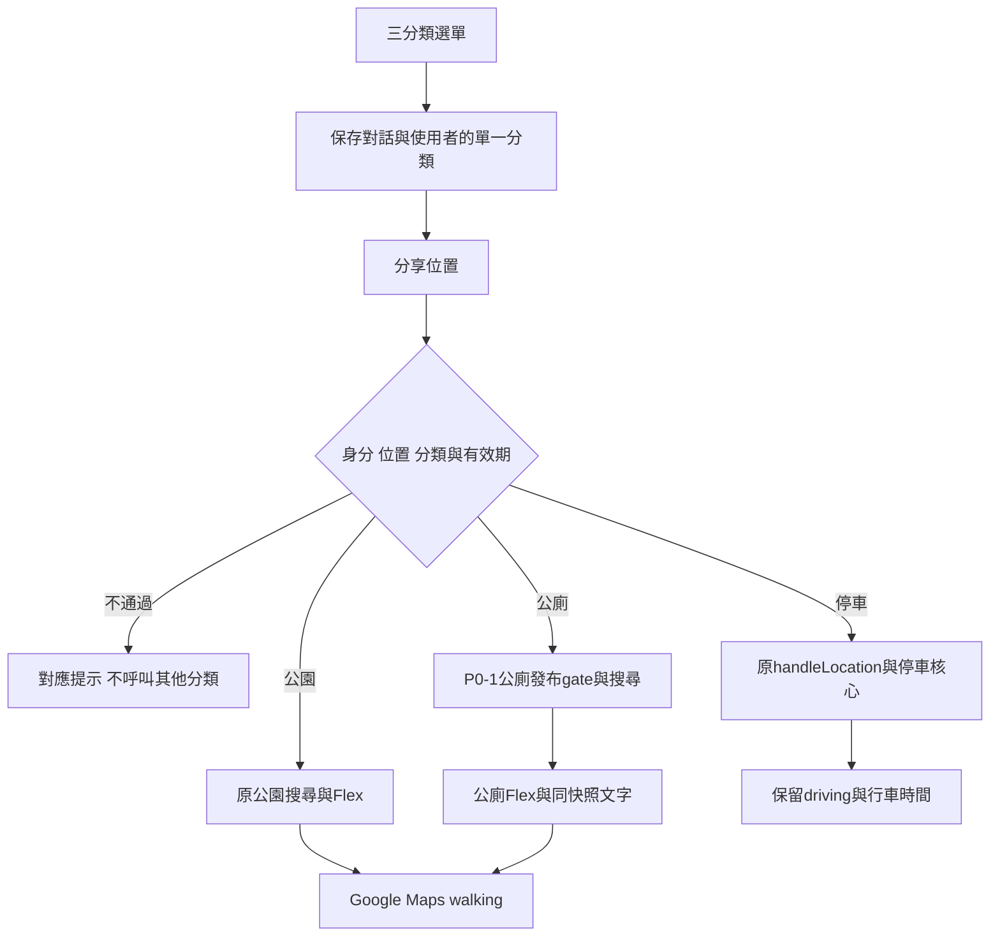

# MVP 1.0 P0-2：LINE 三分類查詢整合

日期：2026-10-21（Asia/Taipei）。分支`feature/flex-message-v2`；基準`e825558`，先行失敗測試Commit `e547f2f`。本輪只有Git原始碼與離線驗收，未部署、未改正式Webhook URL、GAS、Sheets或核准資料。

## 完成範圍與操作流程

主選單只有「停車」「公園」「公廁」三個message action，不新增遊具篩選。

1. 輸入「選單」或「主選單」查看三分類，點選分類。
2. Bot提示分享位置，分類有效10分鐘，可返回主選單或重新選擇。
3. 分享有效位置後：停車呼叫原`handleLocation`；公園呼叫原`buildParkFlexReply_`／`parkSearch_`；公廁呼叫`buildToiletFlexReply_`／P0-1的`toiletSearch_`。
4. 有結果時顯示Flex；公園／公廁使用walking導航，停車保留driving與原文字＋Flex。
5. 成功準備一次結果後清除本次分類；要再查請重新選擇。

**本輪依P0-2「選擇分類→分享位置」流程，沒有有效分類的直接位置會提示先選分類，不再預設停車。** 逾時、未知類別、快取遺失均不推定停車。這取代前一階段規劃中的「直接位置預設停車」；停車核心演算法與資料來源保留，只改入口。

接受的主要文字包括`停車／停車查詢／停車場`、`公園／附近公園`、`公廁／附近公廁／附近廁所`。未知或同時混用多種類別的文字會提示重新選擇，不沿用先前公園、不改查停車。原已存在的臺北遊具文字指令保留相容，選單不提供遊具項目，沒有新增遊具篩選功能。

## 檔案與架構

| 檔案 | 修改／新增內容 |
|---|---|
| `gas/facility_line_gas.js`（新增） | 三分類辨識、單一對話狀態、10分鐘有效期、逾時／未知／身分提示、公廁Flex與同批文字、空結果分類 |
| `gas/line_webhook_gas.js` | 三分類選單、共用位置提示、`doPost`委派新router；保留原id隱私規則。LINE傳送增加「已嘗試回覆」標記，避免把不確定投遞當查詢失敗再送一則 |
| `gas/park_search_gas.js` | 舊park intent helpers相容至共用狀態；讀表錯誤標記；提供可搜尋筆數metadata；公園空結果分類。距離、遊具過濾與卡片內容未重寫 |
| `gas/facility_search_gas.js` | 提供有型別的資料讀取／格式錯誤，以及可選`details.publishedCount`；P0-1指紋與發布規則不變 |
| `test/line/helpers.mjs`、`routing.test.mjs`、`replies.test.mjs`（新增） | 合成Sheets、核准與事件、固定時鐘；62項新回歸 |
| `test/parks/helpers.mjs` | 載入新模組，反映完整GAS runtime相依 |
| `test/parks/mvp.test.mjs`、`search.test.mjs`、`webhook-routing.test.mjs` | 更新12個原UI案例的五選項／預設停車／空資料舊預期；加明確選停車仍呼叫原核心的斷言，不跳過原案例 |
| `.github/workflows/offline-tests.yml` | 新增LINE套件與`line.tap`保存；沒有部署步驟或正式憑證需求 |
| `gas/README.md`、本文件、測試報告及examples | 相依與新流程、限制、實測與回復說明 |

runtime須一起載入`line_webhook_gas.js`、`park_search_gas.js`、`facility_search_gas.js`、`facility_line_gas.js`。缺少router模組時Webhook提示系統暫時無法查詢，不默認停車。本輪沒有把這些檔案複製到正式GAS。



## 狀態與隔離契約

- key沿用`parkIntentKey_`的SHA-256截短對話＋userId形式，保留舊快取相容；分類資料改成version 1 JSON，只有category、原公園條件、到期毫秒與requestId，不存使用者位置、原始userId或群組ID。
- 每位使用者在不同group／room／DM的選擇分開；同群不同人分開。group／room沒有userId或對話ID時不保存分類，不拿群組ID冒充使用者，請到一對一查詢。
- 重複選擇同分類會更新10分鐘期限；切換分類直接取代舊值。返回選單清除狀態。
- 主值TTL600秒，另有同內容的6小時pending marker，用於辨認主值到期／提前逐出。兩者皆遺失或marker也到期時，仍要求重新選擇，不會推定停車。
- 合法十進位字串位置先轉為數字再進既有查詢，不修改來源事件；無效位置不清除已選分類。公園／公廁資料或查詢錯誤保留分類供期限內重試；成功建立回覆後，在送LINE前清除。停車因既有查詢與回覆結合，先消費分類再呼叫原核心；失敗會明確提示，不預設重查。
- 清除時比對request snapshot，避免舊查詢完成時清掉已被取代的新選擇。Cache get／remove並非跨執行交易，**尚無並行重送的嚴格exactly-once保證**；本輪驗證順序事件隔離與可重現的查詢中切換，正式負載／LINE redelivery仍待隔離驗收。
- LINE網路例外不重送；只有已知400拒收Flex才嘗試一次文字，文字也失敗即停止。錯誤回覆不發動第二次停車或公廁查詢。

## 提示分類與資料來源

| 狀況 | 使用者提示與判定 |
|---|---|
| 未選分類／未知分類 | 請先選擇分類；不呼叫停車、公園或公廁 |
| 已逾時 | 本次分類已逾時，請重新選擇 |
| 無法隔離身分 | 請在一對一聊天室選分類並分享位置 |
| 無效位置 | 位置座標異常，請重新分享台灣位置；不查表，不消費既有分類 |
| 附近無符合資料 | 已有可搜尋發布資料，但3km內沒有符合結果 |
| 地區未開放 | 成功讀取／搜尋後，無結果且查詢點在宣告服務粗框之外 |
| 無已核准發布資料 | P0-1發布與品質gate後，可搜尋全體筆數為0；不寫成附近沒有設施 |
| 資料表格式或讀取失敗 | 缺來源分頁、必要表頭／重複表頭、工作簿或分頁讀取例外等；不轉成空結果 |
| 系統暫時無法查詢 | Cache異常、非資料存取型別的程式／搜尋錯誤、缺模組等 |

公園／公廁查詢以可選details物件回傳`publishedCount`（**距離及遊具條件之前**），以區分「發布資料母體為0」與「3km內無符合」。不另外重查Sheets，不使用候選表，不以核准表原始列數充當可發布數。來源變更、資料品質不合格或指紋失效的列不計入。

地區提示只使用雙北服務粗框24.7–25.4／121.2–122.1，向外加3km容許，且在成功讀取、無結果之後判斷；**不是反查縣市、GIS行政界線或公廁全市覆蓋驗收**。不按使用者所在城市硬排另一側公園／新北公廁。框內的臺北區域仍可能看到新北公廁的無結果提示；選單及提示說明公廁僅提供新北已核准資料。若需要逐行政區「尚未開放」判定，仍需經驗收的coverage/GIS來源，本輪不推造。

## 公廁Flex與發布保護

每張公廁卡包含名稱、行政區＋地址、直線公尺、開放時間、無障礙、尿布臺、出入限制及walking導航按鈕；最多5張。名稱60字元、位置160字元、額外欄位120字元上限，固定卡片結構；合成長資料測試檢查每bubble小於30KB、carousel小於50KB、altText不超過400字元。

`UNKNOWN`、空值、未知／未確認等一律顯示「未確認」，不推定沒有、24小時或已確認入口。樓層與入口／開放狀況依原資料與現場，不將代表點說成公廁入口。

renderer只從`toiletSearch_`的結果產卡，透過P0-1 `facilityNavigationUrl_`核對publication與目的地一致，驗距離與最多5筆；原始資料列、不含publication或目的地被改動的結果會成為系統失敗提示，不建立導航。Flex與文字備援共用同次結果，不重查；LINE JSON不含指紋、核准人或fallback私有欄位。

P0-1以下七個函式與基準逐字相同：`facilitySourceFingerprint_`、`facilityReleaseFor_`、`facilityParkPublication_`、`facilityRankNearby_`、`facilityNavigationUrl_`、`facilityReleaseDate_`、`facilityEvidenceUrl_`。本輪只在I/O加錯誤型別與搜尋metadata，沒有放寬發布資格、改寫狀態或產生核准清單。

[合成LINE訊息範例](examples/P0-2_LINE_MESSAGES.json)含實際renderer輸出的三分類選單、位置提示、公園Flex、公廁Flex、無核准文字與停車Flex。公園／公廁使用合成Sheets及合成發布gate；停車範例只呼叫既有renderer，不代表TDX端對端查詢。

## 停車與公園回歸

Webhook原103個頂層函式中，只有選單、位置提示、doPost與replyLine四個函式修改；其餘99個函式與P0-1基準相同。新增`papaKingPostReply_`標記已嘗試LINE傳送，沒有改handleLocation、TDX、Static Fallback、行車時間、月額度或資料來源。

原170個公園／Webhook案例保留數量，12個UI案例改為本階段明確需求（選單3類、未分類位置不推停車、已無發布資料的正確提示）。其餘搜尋／排序／發布gate／備份回復與舊文字篩選案例保留；受影響的UI測試同時明確驗證選「停車」後仍走原處理函式。這不是把不相容的舊預期冒稱原封不動通過。

本輪實際結果：新LINE62、公園170、P0-1設施77、停車72、來源33、審核22，**共436項離線測試通過**。完整命令、紅綠紀錄與限制見[P0-2測試結果](P0-2_TEST_RESULTS.md)。遠端Actions尚未讀回，沒有正式LINE schema或投遞驗收。

## 剩餘上線阻擋

1. 真實「設施發布核准」尚未取得／人工核准；無清單時新北公園／公廁為0。未核准原9筆或任何新公廁，未匯入測試資料。
2. 正式GAS全檔／版本／部署與Git的對照、Google唯讀權限及實際Sheet schema未讀回。
3. 尚無官方LINE schema API、真實手機收卡／導航、隔離GAS／LINE端對端證據；不能以合成JSON取代。
4. 行政區coverage/GIS、實際入口／樓層與開放時間仍待資料驗收。原公園一般搜尋仍要求設施表，無表會明確報資料錯誤。
5. Cache非交易、LINE重送／並行負載、快取配額、正式錯誤處置仍需隔離演練。
6. 現有GAS入口未驗LINE簽章，仍需核對既有上游或另案安全入口及發版／回復計畫；不動sponsor-worker。

本輪不新增Script Properties，只有既有PARK_SHEET_ID讀取與暫存分類Cache寫入；不寫正式Sheets、不執行B4-5、不地理編碼、不部署、不合併main。到此停止，下一階段須另行核准。

## Commit、diff與回復

紅燈測試`e547f2f`；實作SHA列於交付`FINAL_RECEIPT.json`與最後驗收回覆。完整patch `P0-2.diff`以`e825558`為基準，原始log／保護證據保留`.local/mvp1-p02-20261021/`。

若需要回復，先確認工作目錄乾淨，在工作分支建立新revert commit（本輪未執行）：

```bash
git revert --no-commit <P0-2實作Commit> e547f2f
git diff --cached
# 檢查並執行P0-1原374項回歸，再commit回復
```

同時回復實作與紅燈測試，保留P0-1成果；只回復實作會留下依新功能而失敗的測試。沒有正式資源變更，因此本輪無需回復正式Sheets／GAS／Webhook。
