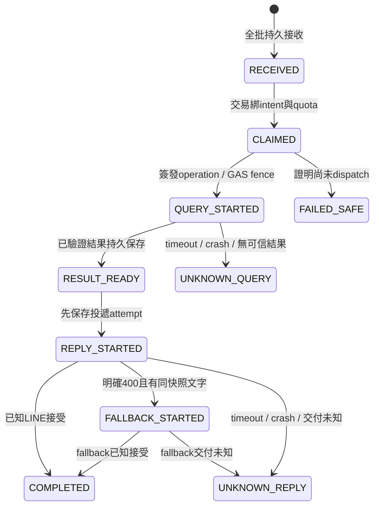

# P0-4 去重、並行與額度一致性設計

2026-10-21 UTC，建議設計，未實作。依[ADR選項C](P0-4_WEBHOOK_ADR.md)。核心原則是每種狀態有單一權威與明確失敗語義；不嘗試用Cache跨GAS與LINE作transaction。

## 資料所有權

| 狀態 | 權威／寫入者 | 主要鍵與規則 |
|---|---|---|
| LINE事件、工作／投遞狀態 | ingress耐久協調器 | `(environment, channelId, webhookEventId)`唯一；eventId缺漏不做付費query，不以replyToken補鍵 |
| 分類意圖與600秒TTL | 同一協調器transaction | HMAC(channel,source.type,conversationId,userId)的scope；user／group／room與成員隔離；intentVersion單調遞增 |
| 每月／選用每日應用quota | 同一協調器transaction | env＋channel＋month/day＋匿名user/global；工作reservation唯一且不重扣；既有月政策需移轉 |
| GAS operation執行fence | GAS Script Properties＋ScriptLock | opId＋requestHash＋STARTED／DONE／UNKNOWN／時間；只阻止第二次執行，不作LINE投遞帳本 |
| 每key頻率、供應商attempt預算 | GAS持久計數＋同ScriptLock | source/account-or-key/window；在實際外呼前reservation；所有呼叫者必須合作 |
| 查詢加速、資料讀取快取 | CacheService／既有停車Cache | 可遺失，不擔任intent、ledger、quota或fence的最終權威 |
| 設施發布核准 | 既有唯讀Sheets gate | 不改指紋／座標／人工核准條件，與入站安全獨立 |

GAS收到的分類必須來自已驗證envelope，不接受使用者body自填 `approved` 或 quota bypass。工作在協調器已做應用quota reservation，GAS新路徑不得再呼叫原 `consumeQuota` 重扣；需明確query adapter呼叫原 `buildReply`，而非用公開參數跳過原保護。停車解析／TDX來源／Maps排序本身保持原語義。

## 去重鍵與事件接收

1. 簽章驗證成功後才解析。批次schema與大小先驗證，再在一個transaction入帳全部合法events與待處理job；重複eventId讀既有狀態。整批無法持久接受則不回成功，不做 `slice(0,10)` 後ACK。unsupported event記ignored且不query；缺必要身分／ID的message記rejected或整批4xx，依契約不默默查停車。
2. event語義hash涵蓋type、message.id／type／位置或文字、source與timestamp等業務欄位；**排除replyToken、deliveryContext.isRedelivery及傳送包裝差異**。合法redelivery可能改token／旗標，不能因此當新事件；同key而語義內容不同視為conflict，零新query。raw bytes digest另記去識別稽核用途。
3. isRedelivery只是提示，不是去重鍵；false也可能重複，true首次看見仍可接收。replyToken為敏感投遞能力，不能作業務ID，也不能因新token重開已處理query。
4. provisional事件tombstone保留7天，raw event／replyToken／位置採必要的最短加密保存，完成後刪除原body；精確期限待隱私與平台配額核定。7天是產品操作政策，不是LINE最長重送保證。過期後不能無條件把舊事件當全新query；須以經驗簽timestamp／watermark標為stale並提示新操作，接受可能漏處理極延遲事件的取捨。
5. 同batch保持順序；同scope接受後配單調序號。跨請求不假設網路有序；已見事件不再改狀態，首次見但低於scope watermark的延遲舊命令不覆寫新意圖。timestamp相同用接收序號決定，不把ULID字串排序推定成LINE的完整因果次序。

## 分類與query交易

- 新分類完整record一次寫入：`kind,intent,intentVersion,selectedAt,expiresAt,lastSelectionEventId`。期限以受驗證事件時間與接受時間較早者起算600秒；未來時鐘偏差超限拒絕。重送不延長TTL，重選的新event可刷新。menu／unknown依原規格取消／阻止查詢，不默認parking。
- 有效新位置在同一transaction完成event claim、檢查scope與expiresAt、綁定intentVersion／位置hash、query job唯一鍵與應用quota reservation。無效位置不消耗分類，不做付費query；未知／過期分類只提示重選。
- 相同位置event在任何狀態都不能再讀「目前intent」改查別類。新位置event則可讀當前分類。重複請求只回事件狀態；不得為了告知duplicate再用同replyToken寄一次提示。
- query完成只操作其綁定的版本；若scope有較新版本，完全不清除它。同版本成功可標consumed，失敗仍可保留原分類及原expiresAt供**新的位置事件**重試，不能延長TTL或重啟舊ID。scope／job記錄須支援此差異，避免一個consumed布林使舊query覆蓋新分類。
- 不跨網路持SQL transaction或GAS ScriptLock。DB故障、lock逾時、狀態不明時停止新query，回明確暫時錯誤或保留pending；不能回無結果、轉停車或放行未記錄額度。

## 工作狀態與恢復

ignored／rejected／expired／failed-final為其他終態。lease包含owner、版本及deadline；重複claim被拒，舊owner的結果不可覆寫新版本。**租約到期不代表舊HTTP呼叫已停止**：

| 狀態 | 重送／期限到期時行為 |
|---|---|
| RECEIVED／證明未dispatch的CLAIMED | 可原子重新領取，不新增quota reservation；保留原分類綁定 |
| QUERY_STARTED但不知GAS是否執行 | 只查受驗證operation status；GAS STARTED／UNKNOWN不自動重跑。若無法證明未執行，轉UNKNOWN_QUERY並停止，不能「換owner再算一次」 |
| RESULT_READY | 使用已持久結果，絕不重查TDX／Maps／Sheets；超過reply期限標expired不改用push |
| REPLY_STARTED／UNKNOWN_REPLY | 不盲目送相同或新token，也不自動push；記錄未知、告警。可能使用者未收到，需要新操作，不承諾exactly-once |
| COMPLETED／FAILED_FINAL／expired | 返回既有內部狀態，零query、零再次LINE回覆 |

GAS在operation fence持久寫STARTED後才外呼，若寫入或確認有疑義則不外呼。重複op相同hash不再查；不同hash拒絕。fence儲存有容量與保留期，接近上限先停止新job並告警；不以「刪掉未決記錄」騰空重做。暫定容量與實際Properties限制在隔離測試後核定；若無法容納政策要求的保留期，改採受驗證的外部fence或搬移provider執行，不降低去重保證。

若GAS結果已回但協調器未保存，query可能已耗額：不能因receipt只有hash無完整結果就再算。可恢復結果須另有受控短期快照；若無，明確UNKNOWN_QUERY。協調器、GAS fence與LINE不是同一transaction，這些失敗邊界不能被一個DB unique key消除。

## LINE回覆副作用

入口為唯一投遞owner，保留既有文字與Flex產物；發送前寫attempt／token版本／結果hash，發送後保存已知結果。不把sponsor push的 `X-Line-Retry-Key` 類推到reply；本輪沒有證據reply提供同樣去重保證。

200標completed；明確400僅原有規格允許的一次同快照文字備援，前置耐久 `FALLBACK_STARTED`、不重跑query；第二次400終止。429／5xx或網路不確定不自動重送，依P0-2保守政策記失敗／未知。回覆期限以後續核對的官方限制及本地安全餘量設定；不能用舊event的新token無限延長，更不能超時轉push。400可能是token失效而非Flex問題，故只有一次有界嘗試，不宣稱一定可恢復。

## LockService／PropertiesService／CacheService界線

| 服務 | 適合 | 不可宣稱／故障策略 |
|---|---|---|
| ScriptLock | 同Script ID合作程式間的短fence／API計數臨界區；tryLock超時則零外呼 | 不跨不同Script ID／Cloudflare；不能覆蓋網路副作用；所有writer須遵守，不能混用舊部署計數 |
| UserLock／DocumentLock | 不採作此全域協調器 | executeAs owner不等於LINE使用者；standalone webapp無可靠document lock上下文 |
| Script Properties | 小型持久fence、來源別計數，搭ScriptLock；逐筆bounded資料 | 無SQL交易／CAS／無限容量；多key部分成功會發生。先reserve再外呼，部分寫入失敗寧可多扣並停止，不自動退掉可能已用額度 |
| CacheService | 加速、既有結果快取、失敗短節流 | 可提前逐出，TTL非持久承諾；miss不可重設quota／允許重作job；不可當跨服務鎖 |

## 配額與API attempt政策

應用quota沿用每月一次有效停車查詢嘗試的語義；白名單、85%公共份額、群組userId行為需保留。job claim和reservation同交易，同ID只扣一次。只有證明尚未dispatch時才可撤銷reservation；外呼開始或未知不退，不用reply是否成功決定是否退款。每日user/global quota目前不存在，需先核定數值／timezone再新增；未設定的行為必須明訂，不能悄悄以unlimited當上線安全保護。

供應商計數是另一層：GAS所有外呼adapter在發送前持久保留attempt。TDX每key採保守rolling 60秒及既有最多5次政策，逐slot／fallback／輪替分別計；401/403／429標記耗盡與token失效繼續保留。RPC與DirectionFinder fallback是兩個attempt，各扣來源別預算；NTPC分頁、token、反查、基隆定位、LINE attempt分別觀測，不以使用者query數代替外呼數。

每日provider預算採操作時區日界線與可配置安全餘量；實際Google配額窗口未核對前不聲稱與供應商一致。key／account若被其他專案共用，單Script鎖無法限制那些用量；需全域協調或專用key／帳號／保守餘量。單次5筆行車候選限制繼續保留，但不能當每日限制。API預算不足維持原直線距離或明確暫時失敗，不誤報附近沒有設施。

## 切換與剩餘保證

舊GAS Cache intent不直接複製進權威DB；切換時要求使用者重選分類，保留TTL提示。月計數與QUOTA_SALT移轉需安全清冊、核准窗口與可回復版本，禁止重置既有額度。新舊dispatcher不能同時向LINE投遞；未決事件帳本與fence跨回復保留，避免舊版再執行。

這是保留期內、已驗證事件、所有合作writer、持久層與secret未失陷前提下的安全設計。資料庫永久遺失、人工改帳本／強制重試、不同專案共用配額、平台硬故障及LINE未知結果不提供exactly-once或零遺失保證。為避免重複付費及投遞，部分未知狀態選擇不自動重做；這個可用性取捨需使用者在I0接受。
