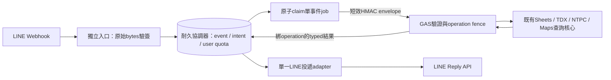

# P0-4 ADR：可信LINE入口與GAS服務邊界

狀態：**建議採用，等待下一階段核准，未實作**。2026-10-21 UTC；基準fbd1abe。

## 可證實的現況

repo部署指引為 LINE → 公開GAS Web App → `doPost` → `handlePapaKingMessage_` → parking／park／toilet → `replyLine` → LINE Messaging API。manifest為ANYONE_ANONYMOUS／USER_DEPLOYING。沒有入站認證、eventId帳本或可信forwarder的程式證據；實際正式上游／URL／部署版本仍待唯讀匯出確認。

GAS取得的是 `e.postData.contents` 文字，可解析JSON；公開Web App事件契約不提供任意HTTP headers，程式沒有可用的 `X-Line-Signature`。即使能重建JSON，也不等於LINE所簽的原始bytes：空白、換行、Unicode編碼與鍵順序都可能不同。不假設 `e.headers` 存在，也不把IP、Referer、userId、公開URL保密或靜態query參數當成LINE HMAC。

現有sponsor-worker只接ECPay通知、驗ECPay MAC及推播LINE；其支付去重不能套作Webhook reply去重，且本任務不得修改它。正式環境如另有proxy，需取得raw-body保留、header轉送、簽章驗證與origin隔離的實際設定才可計入證據。

## 選項比較

| 選項 | 能驗LINE原始簽章 | origin繞過與可靠性 | 改動／結論 |
|---|---|---|---|
| A GAS內補Lock／Cache／Properties，維持LINE直連 | 無可用signature header | 能減部分競爭，仍容許偽造query；無耐久跨服務投遞帳本 | 工期較小但無法解除R8，不作上線方案 |
| B 只加驗簽proxy，仍把原body轉至原公開GAS | 入口可驗 | 外人可直打GAS；proxy timeout後重送可能重做 | 不接受；不能把代理綠燈當整體安全 |
| C 獨立驗簽入口＋耐久協調器＋受保護GAS query服務 | raw bytes原地驗簽 | origin envelope＋job fence；單一intent／event／user quota權威與LINE投遞owner | **建議**；保留搜尋資料核心，但需調整query/reply接縫 |
| D 把三類查詢與資料來源整體搬到可驗簽平台 | 可以 | 可減GAS跨系統邊界，仍有LINE外部副作用不確定 | 重寫Maps／Sheets授權與停車相依較大，不作MVP最小修復 |

不推薦把C再縮成「所有狀態都塞Script Properties」：Properties不是transaction DB，有容量／寫入配額且無CAS；全域ScriptLock只能約束同Script的合作程式，長時間持鎖查網路會阻塞全部使用者。可作有明確容量上限的GAS operation fence／API預算，不作完整事件佇列。

## 推薦C的具體分工

建議新建**獨立Cloudflare Worker＋每個測試／正式channel各一個SQLite-backed Durable Object協調器**，新目錄 `line-ingress/`，不同部署、儲存、secret、監控與權限，與sponsor-worker零共用資料庫／設定變更。這是平台建議，仍需使用者確認方案支持度、預算與帳號權限；不以一般KV eventual consistency代替交易。

協調器內SQL transaction處理事件唯一鍵、批次接受、scope intent與月額度；使用顯式transaction，不假定DO中任意跨await程式自動原子。慢網路呼叫在transaction外，透過原子claim與工作狀態保護。若改選其他平台，必須用同樣可驗證的唯一鍵／transaction／持久job契約，不能只換成記憶體Map。

GAS後續僅組裝查詢結果與既有Flex／同快照文字備援，不在新serving路徑直接寄LINE。入口是唯一LINE reply owner；舊 `replyLine` 可保留用於離線相容測試／受控診斷，不能與新路徑各送一次。這比只包doPost多一個query/reply拆分，原因是要有單一耐久投遞決策；不是重寫停車解析／排序。

## LINE驗簽契約（後續實作）

- 在解析前限流、限制body bytes與Content-Encoding；只接受已定義未壓縮UTF-8 body，超限／未支援encoding拒絕。不要先parse/stringify或對Unicode做正規化。
- 用頻道Channel Secret計算raw bytes的HMAC-SHA256，Base64 decode後與嚴格格式的 `X-Line-Signature` 以平台constant-time primitive比對。缺secret／多重或格式錯誤header fail closed，且不寫事件／query／reply。
- 驗簽後才檢查destination／頻道綁定及payload schema。空events的LINE連線驗證可回成功且零副作用；malformed body回明確4xx，不能用GAS文字OK冒充驗證成功。
- body／nonce大小上限、rate limit、secret雙key輪替與告警需有配置及測試；Channel Secret只在入口secret store，出站Access Token也由入口保管。不要沿用sponsor的Token設定。

## GAS origin envelope契約（後續實作）

新入口不能解決GAS繞過，必須同時改GAS `doPost`：只接受受控envelope；舊LINE裸body一律零外部副作用拒絕。不可「驗證失敗就走舊router」。

建議固定欄位 `v,kid,aud,issuedAt,expiresAt,nonce,operationId,requestHash,payloadBase64,mac`。MAC輸入固定為UTF-8 `JSON.stringify(["PAPAKING_REQUEST_V1",v,kid,aud,issuedAt,expiresAt,nonce,operationId,requestHash,payloadBase64])`；不簽未排序任意object。payload包含已綁定的category、intentVersion、scope digest、查詢輸入與預算授權；requestHash綁定該operation的語義，重用operation但變更座標／分類必須衝突拒絕。

GAS流程：大小／schema／型別 → keyId／實際Script ID audience／環境 → MAC → 時效 → operation／nonce fence → provider預算 → query。嚴格Base64、整數timestamp及欄位白名單；未驗MAC前不信任scope、job或額度。proposed有效期最多120秒、未來偏移最多30秒，只是待隔離校準的操作政策，不是LINE官方時效。查詢超時後的status請求需新envelope，但不得重啟舊operation。

GAS origin secret與LINE secret分開，預定設定名 `PAPAKING_ORIGIN_KEYS`（kid→key）、`PAPAKING_ORIGIN_AUDIENCE` 與期限配置，僅規格未設定。GAS端需固定長度、完整掃描比對MAC，禁止逐字首錯即返；GAS JS比較不宣稱已具可證明的native constant-time，下一階段需評估可用primitive／平台限制與剩餘風險。若此風險不被接受，改採具受管認證的內部服務邊界，而非自行聲稱消除。

origin receipt／response需綁定operationId、requestHash、候選版本、狀態與結果hash，回應MAC用獨立domain `PAPAKING_RESPONSE_V1` 防反射，經TLS及固定GAS目標白名單傳送。GAS ContentService通常不能任意設定HTTP status，故ingress必須解析已驗證的typed結果；不把HTTP200、redirect或字串OK當成功。ContentService redirect的允許主機與行為要在隔離驗證，不能任意follow attacker URL或把origin secret放URL。

## 尚未驗證與取捨

平台能力、最新LINE／Google規格、實際header／body及權限都尚未線上驗證。C需新增持久狀態、secret管理與操作成本，與原免費單GAS部署不同；部署前必須核定。完整事件短暫持久接收涉及userId、replyToken與位置，須加密、限時刪除及限制存取；不能把正式事件複製到Git fixtures。

獨立入口被入侵、secret洩漏、資料庫故障、GAS管理者繞過以及LINE投遞未知仍是剩餘風險。設計只提供受定義保留期／權限／所有合作元件內的去重與保守不重發，沒有端到端exactly-once承諾。
