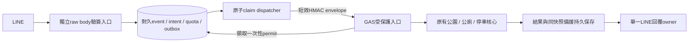

# P0-5 安全架構與成本決策

2026-10-21 UTC；分支 `feature/flex-message-v2`；基準 `e5bf54d13e29db59061a1f3018c34d47bdf9ae98`，serving程式仍為855f5f2。依P0-4五份規劃；本輪不建立資源、不改執行程式、不部署或同步。

**推薦先評估方案A：獨立Cloudflare Worker＋SQLite-backed Durable Object＋受保護GAS。** 方案B以獨立Cloud Run控制入口／dispatcher＋Firestore交易提供相同安全契約，是Google平台替代方案。推薦理由是MVP元件及排程維護較少，不是已證實價格最低；官方價格文件全部被代理阻擋，**本輪沒有可核准的精確月費或免費額度結論**。

不接受單GAS直連或只加驗簽proxy而GAS仍可直接查詢的方案。原11項安全規格仍未修復；無平台／預算核准不啟動實作與資源配置。

## 保存P0-4

- 開始HEAD=e5bf54d、分支正確、工作區乾淨。逐檔核對僅5份P0-4文件與1份包含11個紅燈案例的離線安全測試；無runtime、manifest、sponsor-worker、正式設定或憑證變更。
- private key、GitHub token、Google API key、OAuth token、長literal Bearer樣式掃描零命中，並核對合成測試內容；不把樣式掃描宣稱為絕對秘密偵測。
- ls-remote實際遠端=fbd1abe，等於e5bf54d父Commit；fetch後以FETCH_HEAD核對祖先關係，正常推送 `e5bf54d:refs/heads/feature/flex-message-v2`，輸出 `fbd1abe..e5bf54d`，再次確認遠端=e5bf54d。沒有force、衝突或改寫歷史。
- 保留 `.local/mvp1-p04-20261021/` 全部證據；本輪證據另存 `.local/mvp1-p05-20261021/`。本輪新增文件Commit不包含在上述指定推送內。

## 可行方案比較

| 項目 | A：獨立Worker＋DO SQLite | B：獨立Cloud Run＋Firestore |
|---|---|---|
| LINE驗簽入口 | 新Worker讀raw bytes，HMAC-SHA256及嚴格header驗證；Channel Secret由新secret配置管理 | 新Cloud Run control服務在JSON middleware之前讀raw bytes，以相同規則驗簽；Secret Manager管理 |
| 耐久event／intent／應用quota | 每environment/channel一個DO；顯式SQLite交易／unique key；不能以KV替代 | Firestore transaction原子寫event、scope、quota、outbox；交易重試callback不可含外呼；全域quota doc可能有競爭須負載驗證 |
| 批次與去重 | 有限body內全批入帳才ACK；同eventID不重做；DO alarm分派工作 | 同樣先全批入帳；Firestore交易大小上限須查核；過大批次明確拒收；outbox→Cloud Tasks；Scheduler補掃未排程工作 |
| GAS可信入口 | 短效簽名envelope，拒絕裸body；GAS回呼DO領一次性執行許可 | 相同envelope；GAS回呼control服務，Firestore交易領一次性許可；不是把Cloud Run IAM token直接當GAS Web App身分 |
| 停車並行／每日quota | DO原子event claim＋邏輯quota；GAS ScriptLock保護來源別API attempt counter | Firestore相同原子reservation；GAS來源別控制相同。全域counter若成瓶頸，不能改成無法硬限額的eventual counter而仍宣稱精確 |
| 失敗與恢復 | DO ledger／alarm持久恢復；unknown-query／unknown-reply不自動重發；不跨await持交易 | Tasks至少一次投遞，仍需ledger；outbox解決DB已存、Task尚未建立的間隙；逾時一樣保守不重做 |
| 日誌／告警 | Workers／DO可用觀測功能與保留額度待核；受控事件hash、狀態、延遲、配額；需核定告警接收與可用通知機制 | Cloud Logging／Monitoring、alert policy；容量／日誌排除及保存設定；Firestore pending及Task dead-letter需自行定義操作流程 |
| 部署／回復 | 獨立Worker版本、DO schema相容遷移及GAS版本成套；ledger與permit跨回復保留 | control／dispatcher revision、Task target／IAM、Firestore schema／索引、GAS版本成套；不以程式rollback回滾事件帳本 |
| 成本驅動 | Worker請求／CPU、DO呼叫／等待duration、SQL讀寫及儲存、logs／監控、方案底費（均待核） | 兩Cloud Run服務request／billable duration、Firestore讀寫刪除／儲存、Tasks／Scheduler、egress、logs／secrets／build／image儲存 |
| 主要限制 | 單channel DO為串行狀態協調點；外呼必須離開transaction；GAS回呼不能被長鎖阻塞；平台方案與運算時限待確認 | 元件與IAM較多；任務重送／transaction retry增操作數；跨服務及控制／dispatch不可互相佔滿資源而死鎖 |

兩方案的GAS、LINE、TDX／Maps上限相同，付費入口不會提高GAS配額。不使用sponsor-worker的部署、DO／D1、secret、push去重或正式Token。

## 共同安全架構

圖中GAS→DB為透過驗證控制API，不是直接連SQL或持有資料庫管理金鑰。此方案調整P0-4的每operation GAS Properties fence：**建議改用外部耐久一次性permit**，避免保留大量receipt造成GAS容量瓶頸，詳細見[安全邊界](P0-5_GAS_SECURITY_BOUNDARY.md)。GAS仍保留origin secrets及有界provider counters，沒有因此取消ScriptLock或origin驗證。

分類、位置event與intentVersion綁定；600秒期限、不同使用者與群組隔離、來源指紋發布gate保持不變。原子claim與quota reservation在同一權威交易內；完成不得清除新intent。不承諾跨LINE、GAS與資料庫exactly-once；不確定狀態寧可停止自動重查並要求新操作。

## 建議與選擇條件

| 情境 | 建議 |
|---|---|
| 想保留原GAS核心、元件較少，願意新增獨立Cloudflare服務 | 優先A，先核實DO SQLite方案／duration計費、GAS回呼延遲與配額 |
| 組織已使用GCP且偏好同一IAM／log／帳務治理 | 可選B，接受Tasks／Scheduler與多服務維護；需量測Firestore競爭與poll固定成本 |
| 每月1,000或10,000次HTTP POST | 可用本輪用量模型篩選；不能由月量斷定在免費層內或足以處理尖峰 |
| 每月100,000次HTTP POST | 暫不核准GAS版容量；先驗每日Maps／UrlFetch、GAS並行及fence／provider counter容量，再決定限流、降級或另案搬provider服務 |
| 要求總費用絕對為0或網路攻擊也完全不收費 | 本輪無可承諾方案；須驗實際免費硬上限，並接受超限停止服務及剩餘流量成本風險 |

## 成本決策與下一步

[成本與配額表](P0-5_COST_QUOTAS.md)把1,000／10,000／100,000定義成每月有效Webhook HTTP POST，另換算查詢與內部操作；[CSV](P0-5_COST_SCENARIOS.csv)可交給平台計價器填單價。不是已量測流量，也不把所有LINE reply嘗試當成付費push。

需要核准的不是單一「部署」按鈕：平台／付款帳號與月預算、免費／付費及超額政策、隔離LINE／GAS／資料庫環境、事件資料保存、daily／provider上限、安全未知時不自動重做的取捨。清單及分階段出口見[實作與授權計畫](P0-5_IMPLEMENTATION_AND_APPROVALS.md)。在價格、權限與隔離證據齊備前，只能批准限額驗證計畫，不能將未知費用視為已核准預算。

## 本輪驗證限制

完成三列CSV的公式／單位關係、獨立anchor值、重算一致性、Markdown本地連結及JSON有效性檢查；P0-4證據包CRC與既有SHA-256一致。只有文件及估算產物新增，不重跑436功能回歸或11項安全測試，引用P0-4結果時保留其原日期與未修復狀態。未讀回遠端Actions、未呼叫雲端管理或正式API；來源連線與用量計算不是價格驗收或端到端驗收。
