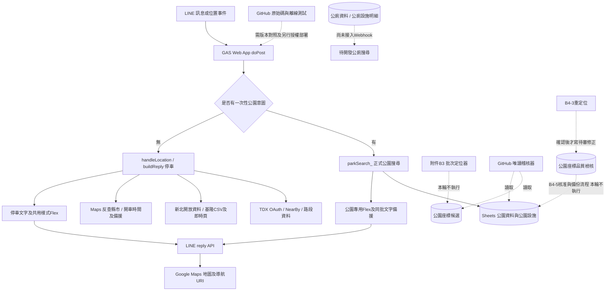

# PapaKing MVP 1.0 系統與資料流程盤點

日期：2026-10-21（Asia/Taipei）。本輪只分析、執行隔離離線測試、建立報告；沒有修改應用程式、測試、CI或正式資源。分析分支`feature/flex-message-v2`，Commit `26b7842ca43946c63bbaa658e5a2a9cbf2cfae62`；本輪GitHub唯讀分支參照也指向相同Commit。

## 可直接做出的決策

原有停車核心可以保留，新增公廁與三分類選單需要開發及獨立驗收。臺北公園已有搜尋、排序、導航與Flex，不需要重寫停車架構。新北公廁資料可以共用附近搜尋演算法，但**不能原樣套用公園表欄位、可用狀態或導覽假設**。

附件B3會產生候選座標；GitHub同名檔其實是後來的唯讀品質稽核器。兩者功能不同，不能直接覆蓋同名檔案。正式搜尋目前不讀候選表，卻只以正式列的「可用」與有效座標作發布門檻，沒有查人工核准證據；MVP仍需建立新北發布清單及驗證。

目前不具備三類整合正式上線驗收條件：公廁搜尋、分類狀態路由、使用者錯誤提示及發布門檻尚有缺口；正式GAS／LINE對應版本與端對端證據均未取得。297項離線測試通過，不能轉述為正式服務已驗證。

## 證據與限制

- 程式：實際讀取`gas/`全部5個JavaScript檔、manifest、README、現有測試與CI；完整函式及SHA見[GAS_FUNCTIONS.md](GAS_FUNCTIONS.md)。根README仍稱Webhook為「全部程式」，與現有5個檔案不符。
- 本次附件：`park_geocoding.txt`，6784 bytes。這是兩個函式的文字檔，**不是整個GAS專案匯出**；附件文字不作執行指示。
- 資料：唯讀重新解析使用者指定主來源《PapaKing 生活設施資料庫.ods》，SHA-256 `16d204f96d56e0d916fd7c414675ca77f1394cfb1eb20324f068f83f96ec444c`；共13個分頁。沒有要求XLSX，沒有修改ODS。資料是該次匯出快照，不證明今天Sheets內容或來源更新日期。
- PK-02E的ODS主來源驗收紀錄、PK-PARK-MVP報告及既有離線成果確實存在。前者驗證來源一致性，不授予座標發布核准；本輪未重做先前17778項活頁簿檢查。
- 未使用Google帳號、Sheets／Script API或LINE／TDX真實服務。2026-10-20文件有代理CONNECT 403紀錄；**本輪沒有重測，不能稱2026-10-21仍403，更不能將代理403說成Google拒絕授權**。目前線上權限與部署版本均待確認。
- `sponsor-worker`、main與所有正式服務均不在修改範圍；本輪不執行Worker測試，避免把舊25項結果冒充本輪執行。

## 系統架構與現況資料流

GitHub是來源版本庫，GAS是實際執行環境，Sheets存放設施資料，LINE負責輸入與回覆；兩者沒有可核對的自動部署同步證據。Google Maps導航URI本身不查API；Maps服務及停車用的Google RPC則是不同外部相依。TDX停車與公園搜尋不是同一資料源，應維持獨立故障範圍。

### GAS檔案角色

| 檔案 | 實際角色、主要函式與相依 |
|---|---|
| `gas/line_webhook_gas.js` | 1925行、103函式。`doPost`分流、`handleLocation`／`buildReply`停車、`consumeQuota`、TDX／NTPC／基隆、行車時間、`flexBubble`／`replyLine`。公廁只見theme與測試示範卡。 |
| `gas/park_search_gas.js` | 251行、17函式。`parkIntentFromText_`、`rememberParkIntent_`／`takeParkIntent_`、`parkRowsAsObjects_`、`parkSearch_`、`parkNavigationUrl_`、`buildParkFlexReply_`。 |
| `gas/park_geocoding_gas.js` | 212行、13函式。唯讀`parkAuditData_`／`runPapaKingParkQualityAudit`／`runPapaKingParkInventory`；不執行地理編碼。核准預檢依賴B4-5的表頭、規則與指紋helper。 |
| `gas/park_b43_regeocode_gas.js` | 77行、2函式。4筆指定ID重定位；預覽仍會耗Maps配額；確認後才寫品質表L:O，仍待人工確認。依賴audit與B4-5 helpers。 |
| `gas/park_b45_sync_gas.js` | 200行、18函式。preview、人工證據預檢、同步、備份、journal、失敗回復與另行確認的rollback。 |
| 附件 `park_geocoding.txt` | B3批次定位器＋候選統計器，2個函式；與GitHub同名模組不是同一版本／職責。 |
| `gas/appsscript.json` | V8、Asia/Taipei、執行者部署帳號、匿名Web App設定；沒有部署ID或目前授權清單。 |

### 停車查詢：保留的精確範圍

`handleLocation`先`consumeQuota`，再`buildReply`：反查縣市→兩條TDX NearBy與即時資料併發→路邊／路外解析→新北Static Fallback→近點的行車時間→各區塊呈現。半徑1km；路邊先取最近10個有效汽車格再分組；路外TDX最多5座、混入市府來源去重；Flex最多3路段＋2場站，不等同所有文字資料都限制5筆。

`rankSections`先依直線距離選行車時間候選，各區塊前3路段／2停車場查時間後重排；不是所有候選都查時間，也不是以開車路程作搜尋半徑。Google RPC整批失敗退Maps DirectionFinder，再失敗退直線距離。`navUrl`是driving。NTPC Static無可靠格位座標時不提供假導航。

TDX 401／403／429輪替、OAuth失敗、快取、NTPC分頁與TWD97、基隆過期、額度等有固定fixtures及72項回歸；並非所有並行執行、真實來源變版、配額、延遲與行車可達性都已覆蓋。`consumeQuota`為Properties讀改寫，未見原子鎖；高併發正確性待驗。原核心可以保持不動，但沒有證據可承諾正式環境零回歸。

### 公園搜尋：目前如何運作

`doPost`把公園條件保存至按對話＋使用者雜湊隔離的Cache，TTL600秒；下一則位置透過`takeParkIntent_`取出並移除。沒有／過期意圖的直接位置分享仍走停車；回選單會清除公園意圖。這不是永久分類狀態，Cache也可能提前逐出。

`parkSearch_`讀`公園資料`與`公園設施`，嚴格驗證必要表頭；使用正式緯經度、`資料狀態=可用`、唯一ID、雙北城市，3km內按實際查詢點直線距離升冪、同距離以ID排序、最多5筆。不依使用者所在城市排除另一市。**不讀候選座標或ODS人工審核表**。

現有滑梯／鞦韆／共融篩選僅臺北，設施有狀態欄時須為可用，使用canonical遊具類別／正向共融名稱，忽略「其他設施」。目前選單仍含3種臺北篩選；本次MVP規格改為暫不提供篩選，後續應移出選單並處理舊指令，不必新增遊具爬取或完成全新北資料。

`buildParkFlexReply_`另有公園專用卡片，不是直接呼叫`flexBubble`；文字與Flex同一查詢快照。地圖為search URL、導航為walking的dir URL，標示代表位置／入口未核實。空結果有文字；無效位置有文字。Sheets／欄位／權限例外目前只被Webhook記錄，可能無使用者回覆。

## 功能現況矩陣

「正式環境無法確認」是缺少版本、實際呼叫或LINE投遞證據，不能用README、示意圖、離線fixture替代。

| 功能 | 程式狀態 | 本輪離線證據 | 正式環境證據 | 檔案／函式 |
|---|---|---|---|---|
| TDX路邊／路外1km與排序 | 已實作 | 72項停車套件涵蓋 | 無法確認 | Webhook `parseOnStreet`、`parseParking`、`nearestWithin` |
| 401/403/429輪替、快取、NTPC分頁與投影 | 已實作 | 停車固定fixtures通過 | 無法確認 | `tdxFetch`、`tdxFetchAll`、`ntpcRowsFromPages`、`twd97ToWgs84` |
| 基隆時效、行車時間與直線備援、月額度 | 已實作 | 停車固定fixtures通過；併發未驗 | 無法確認 | `parseKlcgLive`、`rankSections`、`consumeQuota` |
| 臺北／新北正式公園附近搜尋 | 已實作 | 公園170項含3km、最多5、跨市及排序 | 無法確認 | `parkSearch_` |
| 公園候選不得直接搜尋 | 已實作資料源隔離 | 主表非可用排除通過 | 無法確認 | `parkSearch_`只讀正式表 |
| 新北發布核准與座標值的強制連結 | 尚未實作 | GAP-03：可用正式列無核准證據仍可導航 | 無法確認 | `parkSearch_`沒有review／發布清單核對 |
| 臺北現有遊具篩選 | 已實作，非本次MVP入口 | 現有篩選fixtures通過；真實設施多數待查核 | 無法確認 | `parkIntentFromText_`、`parkSearch_` |
| 三類選單、停車顯式指令、公廁意圖 | 尚未實作 | GAP-01／02重現；舊公園路由回歸通過 | 尚無實作可驗 | `buildPapaKingQuickMenu_`、`doPost` |
| 公廁資料載入／附近搜尋 | 尚未實作 | 本輪只驗ODS結構與座標初篩，沒有公廁端到端測試 | 尚無實作可驗 | 沒有toiletSearch或公廁資料adapter |
| 公廁Flex外觀示範 | 已實作示範元件 | 有示範函式；本輪未單獨呼叫該內嵌test | 無法確認 | `papaKingFlexTheme_`、`flexBubble`、`testPapaKingFlexV2_` |
| LINE reply文字／公園400備援 | 已實作 | 公園170項包含同批備援、不重送200/429/500 | LINE schema／投遞無法確認 | `replyLine`、`postLineReply` |
| Sheets錯誤時使用者提示 | 尚未完整實作 | GAP-05確認目前只記錄例外 | 無法確認 | `doPost`事件catch |
| B3候選批次建立 | 附件已實作 | **沒有執行附件**；只有靜態分析 | 無法確認 | `runPapaKingParkGeocodingBatch` |
| 唯讀品質稽核與分級 | 已實作 | audit與來源工具fixtures通過 | 沒有live Sheets讀回 | GitHub `park_geocoding_gas.js` |
| 安全同步／回復 | 已實作 | 公園套件含mock備份／失敗回復 | 真實寫入、逾時及回復未驗 | `runPapaKingParkB45Sync`／`Rollback` |
| GAS版本同步、正式三分類驗收 | 無法確認／整合尚未完成 | 無離線測試能代替 | 無部署清冊與端到端回執 | 無`.clasp.json`綁定證據 |

## ODS資料庫盤點

這是實際ODS內容，不是從README猜測。經緯度為數值欄且符合合理範圍；未用行政區多邊形或實際入口驗證。公廁共點以六位小數分組，不能直接刪除或合併。

| 分頁／範圍 | 本輪實測 | MVP判斷 |
|---|---|---|
| 公園資料（雙北） | 1448列；臺北813，新北635 | 唯一公園ID與正式狀態是搜尋必要條件 |
| 臺北公園 | 812列有效座標且可用；1列待確認 | 快照可搜尋812／813；不是正式LINE驗收 |
| 新北公園 | 9列有效且可用，626待定位；覆蓋9／635＝1.42% | 不等待全部635；保護9筆原座標，先核對可發布子集 |
| 新北原人工審核 | 9列「需要修正」＋「修正座標驗收=已確認」，626未審核；9筆正式列中4筆有B4-5備註marker | 存在歷史確認證據，不能說完全沒審；仍須核對證據、正式值與本次發布範圍，不能只看marker或A級 |
| 公園座標候選 | 635；634有效，NP-480無效；原`檢核狀態`635筆待確認 | 不作搜尋來源；格式通過不等於可發布 |
| 公園設施 | 457列：433待查核、24可用 | MVP不提供遊具篩選，不以設施缺資料阻擋一般附近搜尋 |
| 公廁資料（雙北） | 5481列／5481唯一ID；新北3976、臺北1505 | 當前MVP公廁先限定新北adapter範圍；臺北留存不自動開放 |
| 公廁座標／狀態 | 5481列皆有數值座標，通過新北粗矩形初篩；5281待驗收、200待確認，**無可用列** | 座標完整不代表已驗收；不可把待驗收自動等同可用 |
| 公廁完整性 | 名稱／地址無缺；148缺行政區；5481來源網址、資料更新日期、開放時間均空 | 區域、來源追溯與開放限制需補證；不標示24小時開放 |
| 公廁共點／整併 | 452組，1489個唯一ID；1582自動整併、3699保留獨立、200待人工確認 | 同棟不同樓層／入口可能合理；保留ID與人工判斷 |
| 公廁設施明細 | 7680列，7648唯一設施ID（多32列）；公廁外鍵孤兒0列 | 明細ID有重複需辨識；不能直接inner join造成主表倍增 |
| 公廁整併待確認 | 200列 | 需確認整併及可達位置，不可一律放行 |

公廁缺漏、共點等上表統計為雙北全表；未把雙北數字誤稱新北單市數字。5481有效範圍僅代表粗矩形數值合理，不表示5481皆在新北。

### 欄位差異與讀取契約

- 公園正式表：`公園ID、縣市、行政區、公園名稱、地址、緯度、經度、管理單位、資料來源ID、原始資料ID、來源網址、資料更新日期、同步時間、資料狀態、備註`（15欄）。公園搜尋依表頭名稱解析，不按公廁同欄位位置猜測。
- 公廁主表：`公廁ID、縣市、行政區、公廁名稱、地址、緯度、經度、公廁類型、無障礙設施、尿布臺、兒童座椅、開放時間、管理單位、資料來源ID、原始資料ID、來源網址、資料更新日期、同步時間、資料狀態、備註、設施紀錄數、整併狀態、進入限制、關聯設施ID`（24欄）。需映射ID／名稱／狀態；分類專用欄位不能塞進遊具tags。
- 公廁明細另有`樓層、入口`，主表`進入限制`有樓層／入口字串，1978列非空。這些不是已驗證入口座標；無障礙或尿布臺未知不能顯示為沒有。
- 候選表實際狀態欄為`檢核狀態`，GitHub品質工具canonical為`審核狀態`。需明確傳入`{'審核狀態':'檢核狀態'}`欄位對照；不帶對照會拒絕缺欄，而不是證明資料有635個空狀態。
- 先前官方公園CSV僅`seqno,name,area,address,management,localcallservice,areacode`，無座標或CRS。既有報告的635筆身分匹配不能升級成位置或發布證據。
- `PARK_SHEET_ID`必須是試算表ID，不是先前提供的Apps Script指令碼ID。尚未讀取正式Properties；同一本公廁表的adapter可沿用經核對的workbook handle，不須要求使用者提供Token。

## park_geocoding專項分析

### 附件B3：輸入、處理、輸出

`runPapaKingParkGeocodingBatch`取得ScriptLock，從Script Properties取`PARK_SHEET_ID`，打開正式資料與候選分頁。依候選表第1欄建立existing ID集合，再從正式公園挑新北、資料狀態待定位、候選尚無ID的列，每批最多50筆。

地址沒有「新北市」前綴時補市名＋行政區；用GAS內建`Maps.newGeocoder().setLanguage('zh-TW').setRegion('tw').geocode(query)`，取第一個結果。數值範圍24～26／120～123、回傳地址是否含行政區、地號／路口／定位類型只作簡單警示。

批次最後在`公園座標候選`追加12欄：公園ID、名稱、行政區、原地址、查詢地址、候選緯度、經度、Google回傳地址、定位類型、待確認、備註、查詢時間。無結果時仍可追加空座標＋NOT_FOUND。Quota例外會中止；其他例外只記錄、留待下次。每次間隔300ms，非服務的配額保證。

`auditPapaKingParkCandidates`只讀候選表、用固定欄序統計筆數／唯一ID／有效座標／類型與狀態並Logger輸出；不寫表。它不是逐筆A/B/C稽核，也不產生人工核准。

相依：`parkRowsAsObjects_`來自公園搜尋檔；Properties、Spreadsheet、Lock、Maps、Utilities、Logger是GAS服務。內建Maps不用顯式API key，不代表免帳號授權或無配額；`setRegion('tw')`是偏好，不是行政邊界限制。

### 與GitHub同名模組的差異

GitHub `park_geocoding_gas.js`明確註明它是新建的唯讀audit，**沒有**`runPapaKingParkGeocodingBatch`或`auditPapaKingParkCandidates`。它讀正式、候選、設施與品質表，產生A/B/C、原因、差距與缺漏／重複等；A只代表審核優先。`parkAuditReviewApprovals_`的approved僅匯出值離線預檢，仍非發布或當次正式寫入授權。

因此，若把附件貼上覆蓋GitHub同名檔，會刪去`parkAuditCoordinate_`／`parkAuditNumber_`等，導致B4-3／B4-5相依缺失；若另檔保留，現有兩組頂層函式名稱沒有衝突，但還需專案全檔盤點、欄位對照與禁止自動觸發。MVP線上搜尋不需要安裝或執行B3／B4-3／B4-5。

### 寫入與導航風險

| 作業 | 實際副作用／風險 | 本輪與後續限制 |
|---|---|---|
| 附件B3 batch | 呼叫最多50次Maps；追加候選12欄，雖不改正式公園列仍會改正式試算表 | 本輪完全不執行；後續若需使用應另行審核與授權 |
| 附件candidate audit | 只讀、Logger統計，沒有分級或核准 | 本輪仍未呼叫附件函式 |
| GitHub QualityAudit／Inventory | 只讀表與回傳／記錄，不呼叫Maps、不寫品質表 | 可供後續唯讀盤點，但目前未連正式GAS執行 |
| B4-3 | 預設也會查Maps；確認後寫品質表L:O，標待人工確認 | 「preview」不等於零API，不能在本輪執行 |
| B4-5 Sync | 寫正式緯經度、同步時間、資料狀態與備註；建立備份／journal | 必須IDs＋當次fingerprint＋人工確認，A級不授權 |
| B4-5 rollback | 會回寫正式表，遇外部衝突停止 | 與正式同步一樣需另行明確授權 |
| 正式搜尋 | 不讀候選，但只依正式可用值；正式值被錯誤人工或其他專案改成可用就可能導航 | 發布清單須綁定ID、座標值、審核證據與版本，不能只列ID |

附件風險需在未來重新開啟候選建置任務時修正，**不屬於本次MVP必須啟動的服務**：

1. 第1欄及12欄寫入順序固定，沒有候選表頭驗證或缺漏／重複ID拒絕；正式來源同ID多列可在同一批重複追加。
2. 有候選ID即永久跳過，包含原先NOT_FOUND／空座標，因此失敗不一定會自動重試；回應`OVER_QUERY_LIMIT`若不拋例外可能被當無結果追加，與例外quota中止不同。
3. 只取首結果、地址包含行政區及廣域矩形不是公園或入口證據；空行政區的substring檢查會恆成立，沒有名稱、place_id或行政區多邊形交叉驗證。
4. 寫入前沒有候選備份／journal／交易回復；ScriptLock只能協調同專案合作寫入者，不能阻止人工／其他專案；原始文字直接setValues也需評估公式字串防護。
5. 不產生A/B/C、不將原地理編碼狀態與人工核准分開保存為完整發布證據。審核表是離線人工工具，尚無經驗收的回收結果匯入器；不能直接交B4-5同步。

### 核准與備份流程現況

B4-5要求修正座標驗收已確認、人工審核結果需要修正或核准、有效修正座標、來源、名稱／新北／NTPC_PARK一致；有正式座標或不是待定位時拒絕覆寫，只有同批marker與值完全相符可NOOP。寫前完成整表備份＋PREPARED journal＋flush及再次fingerprint；失敗嘗試還原並記錄狀態；timeout/crash須預覽後另行確認回復。

這些流程有mock測試，卻沒有真實Sheets寫入／中斷回復證據；跨專案／人工編輯競爭、批次逾時及備份留存操作仍須隔離演練。搜尋整合無需觸碰這些寫入路徑。

## 已重現的六個分析觀察

本輪以既有VM harness及合成事件重現，服務全部mock；不執行附件、不呼叫正式API。腳本與JSON保留`.local/mvp1-inventory-20261021/`。

| ID | 觀察 | 影響 |
|---|---|---|
| GAP-01 | 傳「附近公廁」被忽略，接著位置走停車 | 尚無公廁指令或搜尋，不是已整合 |
| GAP-02 | 先選附近公園，再傳停車查詢，位置仍走公園 | 新增停車入口必須清除舊分類意圖 |
| GAP-03 | 新北正式列只要有效座標＋可用，即使沒有人工證據表仍出結果 | 現有測試名中的approved formal實際只測狀態，不是發布憑證 |
| GAP-04 | 純附近公園缺公園設施表仍丟例外 | 不提供遊具篩選時可解除這個不必要依賴 |
| GAP-05 | 公園Sheets例外只log、Webhook回OK，無使用者錯誤訊息 | 需分類專用錯誤提示，不應掉回停車或無回覆 |
| GAP-06 | 共用flexBubble對999/999這類有限數仍建導航 | 共用前必須在adapter／renderer邊界驗證座標範圍 |

## 完成條件逐題回覆

1. **停車可以安全保留嗎？** 架構上可保留核心與1km／行車時間邏輯；72項本輪回歸通過。只改分類入口，仍需隔離GAS／LINE確認零回歸，不能承諾已正式驗收。
2. **臺北公園如何運作？** 公園指令→10分鐘一次性意圖→位置→讀正式公園與設施→可用有效唯一ID→雙北3km／最多5／直線排序→walking代表點導航＋同批文字備援。ODS臺北可搜尋812筆。
3. **新北公廁可直接套用嗎？** 可共用距離、排序、URI與公園卡片模式；需新adapter、狀態／發布契約及樓層／入口呈現。目前3976筆新北公廁有座標，沒有已可用狀態，不能直接全量導航。
4. **park_geocoding會影響正式搜尋嗎？** B3不在Webhook呼叫鏈，寫候選不會立即被搜尋；但會改工作簿，後續錯誤發布可影響導航。覆蓋GitHub同名audit檔還會破壞B4模組相依。
5. **最少修改哪些檔案？** 建議修改Webhook及park_search兩個既有檔、新增一個park/toilet共用設施檔；另加測試／fixtures與文件。詳見[開發計畫](DEVELOPMENT_PLAN.md)，此為規劃，未實作。
6. **距離正式上線還缺什麼？** 三分類實作、公廁可發布子集、新北公園發布證據、錯誤與狀態測試、Flex官方schema、隔離GAS／LINE端到端與部署／回復對照、Webhook來源驗證處置。完整阻擋與驗收證據見開發計畫。
